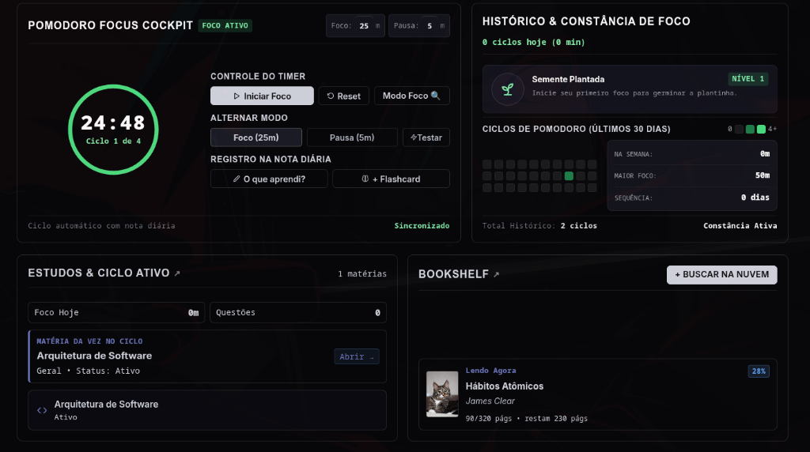
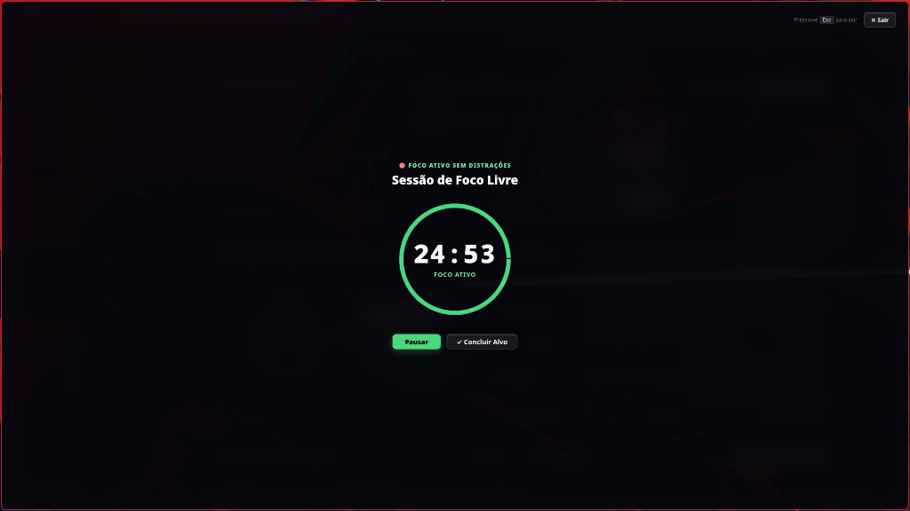
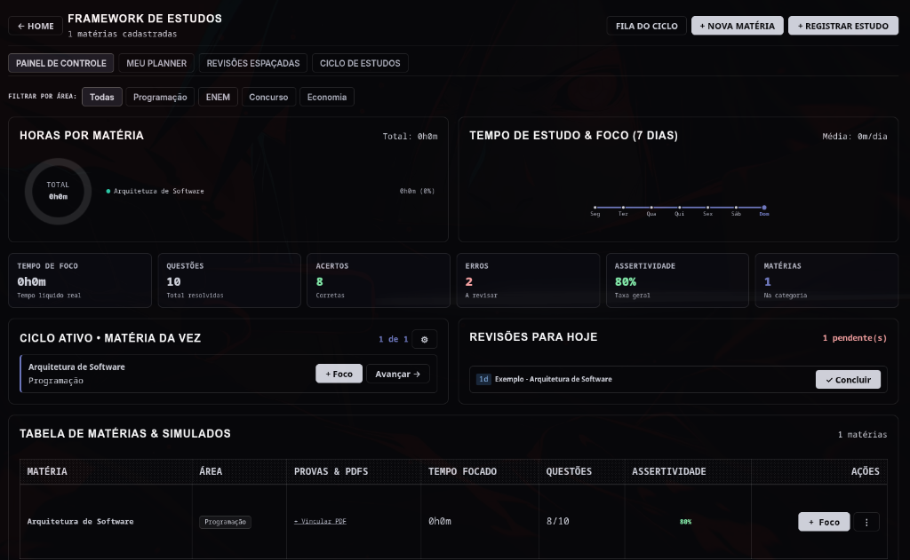
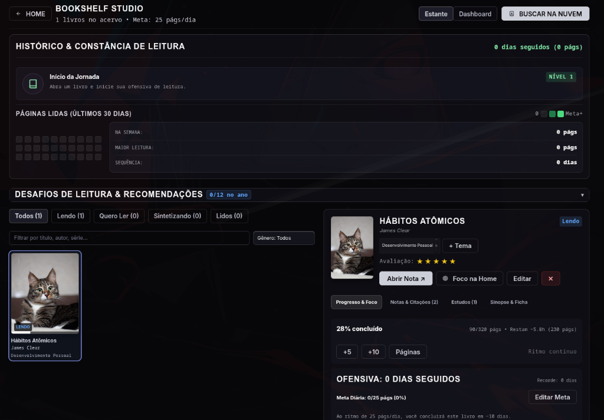

<div align="center">

# Snoopy Vault

Cofre para Obsidian voltado a produtividade pessoal, gestão de estudos, acompanhamento de leituras e execução de tarefas via DataviewJS.

[](https://obsidian.md)
[](https://github.com/blacksmithgu/obsidian-dataview)
[](.obsidian/snippets/05_Snoopy_Theme.css)
[](LICENSE)

<br/>

<p align="center">
  
</p>

<p align="center">
  
</p>

</div>

---

## Visão Geral

O **Snoopy Vault** é uma estrutura de notas e painéis para o **Obsidian**. Ele utiliza componentes dinâmicos em **DataviewJS**, CSS nativo e arquivos Markdown estruturados para consolidar rotinas diárias, ciclos de estudo, estante de livros e projetos em uma interface integrada.

Toda a lógica opera localmente sobre as notas e metadados (`frontmatter` YAML e arquivos de controle JSON), sem dependência de serviços externos, servidores ou aplicativos complementares fora do ecossistema do Obsidian.

---

## Funcionalidades

### Central de Tarefas e Hábitos
- Layout dividido entre **Hábitos do Dia** (30%) e **Central de Execução** (70%).
- Filtros por abas: *Hoje*, *Amanhã*, *Esta Semana*, *Próximas* e *Concluídas*.
- Inserção ágil de tarefas na nota diária (`01_Inbox/Diário/AAAA-MM-DD.md`) com suporte a prioridades (`⏫`, `🔼`, `🔽`) e datas (`📅`).
- Botão direto de foco que transfere a tarefa ativa imediatamente para o Cockpit Pomodoro.

### Templates Conectados de Tarefas
- Botão **`+ TEMPLATE`** no topo da Central de Tarefas para instanciar atividades predefinidas a partir de arquivos JSON em `99_Meta/Templates/Tarefas/`.
- Vínculos automatizados por tipo de template:
  - **Estudos (ex: Idiomas, Concursos):** Cria a nota na pasta de estudos, cadastra a matéria no ciclo contínuo (`ciclo-estudos.json`), agenda a primeira revisão espaçada e programa o tempo de foco no Pomodoro.
  - **Leituras (ex: Livros):** Registra a ficha de leitura na pasta de livros com campos de total de páginas, página atual e capa, refletindo imediatamente na estante.
  - **Projetos:** Cria a nota em `02_Projetos/` com status e prioridade sincronizados com o Kanban.
- Interface para cadastro e salvamento de novos templates customizados diretamente pelo pop-up.

### Cockpit Pomodoro e Modo Foco Imersivo
- Temporizador circular com anel SVG, alternância entre modos de Foco e Pausa e ajuste de minutos.
- **Feedback Sonoro:** Chime harmônico zen sintetizado nativamente via Web Audio API ao final de cada bloco de foco e pausa (sem arquivos de áudio externos).
- **Modo Foco Sem Distrações:** Botão dedicado que aciona overlay em tela cheia com fundo 96% escurecido e desfoque (`backdrop-filter`), isolando exclusivamente o alvo atual e o cronômetro ampliado, com controles de pausa e saída rápida pela tecla `Esc`.
- **Registro Pós-Foco:** Prompt automático para consolidação de aprendizados e criação de flashcards na nota diária ao concluir cada bloco.
- **Histórico e Heatmap:** Matriz de calor dos últimos 30 dias com cálculo de sequência ativa e indicador visual de evolução.

<p align="center">
  
</p>

### Framework Analítico de Estudos
Subdashboard dedicado acessível pela navegação superior (`03_Estudos/Painel de Estudos.md`):
- **Painel de Controle:** Gráfico de distribuição de horas por disciplina (Donut SVG) e histórico dos últimos 7 dias sincronizado aos blocos do Pomodoro.
- **Métricas:** Contadores consolidados de horas líquidas, questões resolvidas, acertos, erros e taxa geral de assertividade.
- **Ciclo Contínuo de Estudos:** Fila rotativa de matérias com controle de "Matéria da Vez" e avanço cíclico.
- **Revisões Espaçadas:** Gestão de revisões programadas, atrasadas e concluídas em intervalos escalonados (1d, 7d, 14d, 30d).
- **Planner Semanal:** Planejamento de blocos de estudo por matéria e modalidade (Teoria, Questões, Revisão).

<p align="center">
  
</p>

### Estante Digital de Leituras (Bookshelf)
Subdashboard dedicado à leitura (`04_Leituras/Painel de Leituras.md`):
- **Grid de Livros:** Visualização em prateleira com capas, marcadores de fita e porcentagem de leitura.
- **Reader Companion:** Painel lateral de controle rápido com botões de incremento de páginas (`+5`, `+10`), avaliação por estrelas, status e notas de citação.
- **Gamificação e Metas:** Sequência de leitura (streak diário), desafio anual e cálculo de previsão de término com base na meta diária de páginas.
- **Integração Open Library:** Busca online direta de títulos e capas sem plugins externos.

<p align="center">
  
</p>

### Kanban de Projetos e Iniciativas
- Quadro com colunas de status dinâmicas (`Em Andamento`, `Planejamento`, `Concluído`).
- Cálculo automático de progresso a partir das tarefas marcadas dentro de cada projeto.
- Menu de ações rápidas (`⋮`) em cada card para transição de status ou exclusão da nota para a lixeira do cofre.

---

## Estrutura do Cofre

```text
Snoopy_Vault/
├── 00_Home/                      # Ponto de entrada do cofre
│   ├── Guia do Usuário.md        # Documentação de apoio
│   └── Home.md                   # Dashboard principal em DataviewJS
├── 01_Inbox/                     # Notas de captura rápida
│   └── Diário/                   # Notas diárias (AAAA-MM-DD.md)
├── 02_Projetos/                  # Notas de projetos e iniciativas ativas
├── 03_Estudos/                   # Notas de disciplinas e matérias
│   └── Painel de Estudos.md      # Subdashboard de estudos
├── 04_Leituras/                  # Fichas de livros e artigos
│   ├── Livros/                   # Notas individuais de livros
│   └── Painel de Leituras.md     # Subdashboard da estante de livros
├── 05_Arquivo/                   # Notas concluídas ou arquivadas
├── 99_Meta/                      # Configurações e módulos do cofre
│   ├── Attachments/              # Imagens e anexos
│   ├── Snoopy/                   # Módulos DataviewJS do dashboard
│   │   ├── core/                 # Microsserviços centrais (TaskTemplates, VaultStore, etc.)
│   │   ├── home/                 # Orquestrador da página inicial
│   │   ├── modulos/              # Módulos da home (Banner, Pomodoro, Tarefas, etc.)
│   │   └── subdashboards/        # Lógica dos painéis de Estudos e Leituras
│   ├── Templates/                # Modelos de notas Markdown e Tarefas JSON
│   │   └── Tarefas/              # Templates de tarefas conectados (JSON)
│   ├── ciclo-estudos.json        # Base de dados do ciclo e revisões
│   └── ⚙️ Configurações.md       # Painel de parâmetros do cofre
├── tests/                        # Testes unitários automatizados (node --test)
├── .obsidian/                    # Configurações e plugins do Obsidian
│   └── snippets/                 # Folhas de estilo (05_Snoopy_Theme.css)
├── LICENSE                       # Licença MIT
└── README.md                     # Documentação geral
```

---

## Atualização Segura e Gestão de Dados

O Snoopy Vault conta com um mecanismo nativo de atualização em 1 clique integrado à nota [`99_Meta/⚙️ Configurações.md`](99_Meta/%E2%9A%99%EF%B8%8F%20Configura%C3%A7%C3%B5es.md), dispensando comandos manuais de terminal:

- **Arquitetura de 3 Zonas:**
  - **Dados Pessoais (`01_Inbox/`, `02_Projetos/`, `03_Estudos/`, `04_Leituras/`):** Intocáveis. O atualizador é estritamente proibido de alterar ou excluir notas pessoais do usuário.
  - **Motor (`99_Meta/Snoopy/`, `.obsidian/snippets/`):** Atualizado automaticamente a partir dos lançamentos estáveis (releases) do GitHub. Arquivos do motor editados localmente pelo usuário são preservados intactos, com a nova versão gravada com o sufixo `.novo`.
  - **Sementes (`00_Home/`):** Documentações e notas base criadas apenas caso ainda não existam.
- **Backup e Rollback Automáticos:** Antes de qualquer alteração, um snapshot atômico é salvo em `99_Meta/.backups/snoopy/`, permitindo reversão imediata com um clique no botão *Desfazer Última Atualização*.
- **Cofre Limpo (Remoção de Exemplos):** Permite mover notas de demonstração (prefixadas por `Exemplo - `) para a lixeira do Obsidian e zerar a fila do ciclo de estudos em 1 clique, deixando o cofre pronto para uso real imediato.

---

## Requisitos e Instalação

1. **Baixar ou clonar o repositório:**
   ```bash
   git clone https://github.com/Arkmedess/Snoopy_Vault.git
   ```
2. **Abrir no Obsidian:**
   - No Obsidian, selecione **Abrir pasta como cofre** (*Open folder as vault*).
   - Aponte para a pasta `Snoopy_Vault`.
3. **Habilitar Plugins da Comunidade:**
   - Em **Configurações > Plugins da comunidade**, ative os plugins instalados.
   - Certifique-se de que o **Dataview** está ativo com a opção **Enable JavaScript Queries** ligada.
4. **Navegação Inicial:**
   - Abra a nota [`00_Home/Home.md`](00_Home/Home.md) para visualizar o painel principal.

---

## Plugins Utilizados

| Plugin | Utilização no Cofre |
| :--- | :--- |
| **Dataview** | Execução dos módulos em JavaScript para montagem dos dashboards reativos |
| **Tasks** | Reconhecimento de marcações de prazo e prioridade nas tarefas |
| **Spaced Repetition** | Revisão de flashcards criados nas anotações |
| **Omnisearch** | Indexação e busca rápida no cofre |
| **Obsidian Git** | Versionamento e sincronização com repositório remoto |

---

## Licença

Distribuído sob a licença [MIT](LICENSE).
